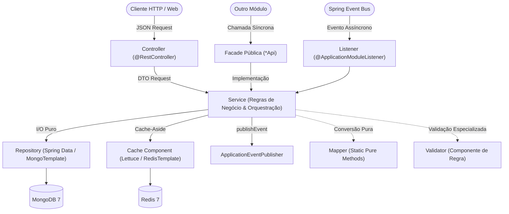

# Arquitetura do Sistema (System Architecture & Design)

**Versão:** 2.0  
**Data:** Outubro de 2026  
**Escopo:** E-commerce Catalog & Faceted Search Engine  
**Documentos Relacionados:** [CODING_GUIDELINES.md](file:///workspace/ecommerce-catalog/docs/CODING_GUIDELINES.md), [SPECIFICATION.md](file:///workspace/ecommerce-catalog/docs/SPECIFICATION.md) e [TEMPLATE_TAREFA.md](file:///workspace/ecommerce-catalog/docs/TEMPLATE_TAREFA.md)

---

## 1. Visão Geral e Princípios Arquiteturais

O **E-commerce Catalog & Faceted Search Engine** é construído como um **Monolito Modular em Java 21** com **Spring Boot 3.5+** e **Spring Modulith**. O objetivo deste documento é definir rigorosamente o posicionamento físico dos arquivos no código, as responsabilidades de cada camada arquitetural (SRP) e as regras que garantem o desacoplamento e a consistência entre módulos.

### Princípios Norteadores
1. **Fronteiras Estritas de Módulo (Package by Feature com Spring Modulith):** O código é particionado em módulos de domínio de primeiro nível (`category`, `product`, `search`). Classes internas residem obrigatoriamente no subpacote `internal/` e são inacessíveis para outros módulos, verificado por testes arquiteturais (`ApplicationModules.verify()`).
2. **Propriedade Exclusiva de Dados (*Collection per Module*):** Cada coleção do MongoDB e namespace de chave do Redis pertence exclusivamente a um único módulo. Nenhum módulo executa queries, mutações ou leituras diretas em coleções de outro módulo.
3. **Simetria e Uniformidade Arquitetural (POLA — Principle of Least Astonishment):** Todos os módulos seguem exatamente a mesma estrutura em camadas (`Controller` → `Service` → `Repository`), com nomes previsíveis para DTOs, mappers e documentos.
4. **Isolamento de I/O e Inversão de Controle:** Repositórios realizam I/O puro no MongoDB; serviços orquestram regras e fronteiras de transação; facades públicas (`*Api`) isolam detalhes de implementação entre módulos.
5. **MongoDB como Autoridade, Redis como Acelerador Efêmero:** O Redis funciona exclusivamente como camada de cache-aside. Se o Redis for reiniciado ou falhar, a aplicação degrada para leitura direta no MongoDB sem interrupção de serviço ou perda de dados.

---

## 2. Estrutura de Diretórios

O projeto segue a estrutura padrão do Maven e as convenções do Spring Modulith:

```text
ecommerce-catalog/
├── docs/
│   ├── ARCHITECTURE.md                      # Estrutura do código, camadas e SRP
│   ├── CODING_GUIDELINES.md                 # Padrões de código Java e boas práticas
│   ├── SPECIFICATION.md                     # Requisitos, fluxos, diagramas e contratos
│   └── TEMPLATE_TAREFA.md                   # Template para tarefas do kanban
├── docker-compose.yml                       # MongoDB 7 (rs0) + Redis 7
├── pom.xml                                  # Dependências (Spring Boot, Modulith, Testcontainers)
└── src/
    ├── main/
    │   ├── java/com/ecommerce/
    │   │   ├── CatalogApplication.java     # Bootstrap (@SpringBootApplication + @Modulithic)
    │   │   │
    │   │   ├── shared/                      # Módulo OPEN: utilitários transversais sem regra de negócio
    │   │   │   ├── money/                   # Value Object imutável Money (cents em long + Currency)
    │   │   │   ├── error/                   # DomainException, FailureCode, ProblemDetailHandler (RFC 7807)
    │   │   │   ├── audit/                   # AuditMetadata (createdAt/By, updatedAt/By) e AuditorAware
    │   │   │   ├── pagination/              # CursorPage, CursorEncoder e decodificador Base64URL
    │   │   │   └── config/                  # MongoConfig, RedisConfig, JacksonConfig
    │   │   │
    │   │   ├── category/                    # Domínio: Taxonomia e Definição de Atributos (US-01)
    │   │   │   ├── CategoryApi.java         # Facade pública (interface consumida por outros módulos)
    │   │   │   ├── CategoryView.java        # DTO público (record com dados da categoria)
    │   │   │   ├── AttributeDefinition.java # Contrato público de atributos (record)
    │   │   │   ├── CategoryChanged.java     # Evento de integração público (record)
    │   │   │   └── internal/                # Implementação privada do módulo category
    │   │   │       ├── CategoryController.java   # Transporte HTTP (/api/v1/categories)
    │   │   │       ├── CategoryService.java      # Regras de negócio, ancestrais e cálculo de herança
    │   │   │       ├── CategoryRepository.java   # Spring Data MongoRepository na coleção categories
    │   │   │       ├── CategoryDocument.java     # Mapeamento @Document("categories") com audit
    │   │   │       ├── CategoryMapper.java       # Funções puras de conversão DTO <-> Document
    │   │   │       ├── CategoryCache.java        # Cache-aside Lettuce para cache:category-tree
    │   │   │       ├── CategoryEventListener.java# @ApplicationModuleListener para evicção de cache
    │   │   │       └── dto/                      # Records privados de request/response HTTP
    │   │   │           ├── CreateCategoryRequest.java
    │   │   │           └── CategoryTreeResponse.java
    │   │   │
    │   │   ├── product/                     # Domínio: Produtos e Ciclo de Vida (US-02, US-04)
    │   │   │   ├── ProductApi.java          # Facade pública
    │   │   │   ├── ProductSnapshot.java     # DTO público imutável (record)
    │   │   │   ├── ProductChanged.java      # Evento de domínio público (record)
    │   │   │   └── internal/                # Implementação privada do módulo product
    │   │   │       ├── ProductController.java    # Transporte HTTP (/api/v1/products)
    │   │   │       ├── ProductService.java       # Validação, publicação, concorrência @Version
    │   │   │       ├── ProductRepository.java    # Spring Data MongoRepository na coleção products
    │   │   │       ├── ProductDocument.java      # Mapeamento @Document("products") (Attribute Pattern)
    │   │   │       ├── ProductMapper.java        # Mapeamento de atributos Map<String,Object> <-> List<AttributeValue>
    │   │   │       ├── AttributeValidator.java   # Validador de tipos/enums contra CategoryApi
    │   │   │       ├── ProductCache.java         # Cache-aside Lettuce para cache:product:{idOrSlug}
    │   │   │       ├── ProductEventListener.java # @ApplicationModuleListener (invalidação reativa)
    │   │   │       └── dto/                      # Records privados de request/response HTTP
    │   │   │           ├── CreateProductRequest.java
    │   │   │           ├── UpdateProductRequest.java
    │   │   │           └── ProductResponse.java
    │   │   │
    │   │   └── search/                      # Domínio: Motor de Busca Facetada (US-03)
    │   │       ├── SearchApi.java           # Facade pública
    │   │       └── internal/                # Implementação privada do módulo search
    │   │           ├── SearchController.java     # Transporte HTTP (/api/v1/products/search)
    │   │           ├── SearchService.java        # Parsing de filtros dinâmicos attr.* e ordenação
    │   │           ├── ProductSearchRepository.java # Aggregation Pipeline com $match e $facet
    │   │           └── dto/                      # Records de busca e agrupamentos de facetas
    │   │               ├── SearchQuery.java
    │   │               ├── SearchResult.java
    │   │               └── FacetGroup.java
    │   │
    │   └── resources/
    │       ├── application.yml              # Configurações gerais e fail-fast
    │       ├── application-local.yml        # Perfil local (pretty logging)
    │       └── logback-spring.xml           # Configuração de logs estruturados (JSON stdout)
    │
    └── test/java/com/ecommerce/
        ├── ModularityTests.java             # Validação estrita de fronteiras com Spring Modulith
        ├── category/                        # Testes de integração de Category (@ApplicationModuleTest)
        │   ├── CategoryServiceIT.java
        │   └── CategoryCacheIT.java
        ├── product/                         # Testes de integração de Product (@ApplicationModuleTest)
        │   ├── ProductServiceIT.java
        │   ├── AttributeValidatorTest.java
        │   └── ProductCacheIT.java
        ├── search/                          # Testes de integração de Search (@ApplicationModuleTest)
        │   └── ProductSearchRepositoryIT.java
        └── support/                         # Suporte compartilhado (MongoDB e Redis Testcontainers)
            ├── AbstractIntegrationTest.java
            └── TestContainersConfig.java
```

---

## 3. Arquitetura em Camadas e Responsabilidades (SRP)

Cada módulo de domínio organiza seu código interno seguindo estritamente a separação em camadas:



### 3.1. Controllers (`*Controller.java`)
- **Papel:** Camada de adaptação de transporte HTTP (REST).
- **Responsabilidades:**
  - Decodificar payloads JSON e validar restrições via Bean Validation (`@Valid`, `@NotNull`).
  - Extrair cabeçalhos obrigatórios (`If-Match` para controle de concorrência, `X-Actor` para auditoria).
  - Delegar a execução para o `Service` do módulo.
  - Serializar DTOs de resposta (`record`) com status HTTP semântico (`200 OK`, `201 Created`, `204 No Content`).
  - Mapear exceções de domínio para a RFC 7807 (`ProblemDetail`) via `@RestControllerAdvice`.
- **Proibições:**
  - Nunca acessar repositórios (`*Repository`) ou templates (`MongoTemplate`, `RedisTemplate`) diretamente.
  - Nunca conter regras de negócio, validações taxonômicas ou cálculos.
  - Nunca retornar instâncias de `@Document` para o cliente HTTP.

### 3.2. Services (`*Service.java`)
- **Papel:** Núcleo de regras de negócio, validações de domínio e orquestração.
- **Responsabilidades:**
  - Desacoplados de qualquer protocolo HTTP (`HttpServletRequest`, headers web).
  - Coordenar o fluxo: validar contra outras facades, consultar o cache/banco, executar mutações e disparar eventos.
  - Definir demarcações transacionais (`@Transactional`) quando houver gravação multi-documento ou registro de outbox.
  - Publicar eventos de domínio via `ApplicationEventPublisher`.
  - Aplicar tratamento de concorrência otimista capturando `OptimisticLockingFailureException`.
- **Proibições:**
  - Nunca chamar classes dentro do subpacote `internal/` de outros módulos.
  - Nunca conter código de formatação HTTP ou serialização JSON.

### 3.3. Facades Públicas (`*Api.java`)
- **Papel:** Contrato público exposto pelo módulo para consumo síncrono por outros domínios.
- **Responsabilidades:**
  - Interface Java localizada na raiz do pacote do módulo (ex: `com.ecommerce.category.CategoryApi`).
  - Recebe e devolve exclusivamente tipos públicos primitivos, Value Objects de `shared` ou DTOs `record` imutáveis.
- **Proibições:**
  - Nunca vazar entidades internas, documentos `@Document` ou exceções de infraestrutura do driver MongoDB/Redis.

### 3.4. Repositories (`*Repository.java` e `*SearchRepository.java`)
- **Papel:** Camada pura de I/O de dados com o MongoDB.
- **Responsabilidades:**
  - Herdar de `MongoRepository<T, ID>` para operações CRUD convencionais.
  - Utilizar `MongoTemplate` de forma limpa para montagem de pipelines de agregação complexos (`$match`, `$facet`, `$unwind`, `$bucket`).
  - Executar consultas cobertas por índices sem carregar dados desnecessários na memória.
- **Proibições:**
  - Nenhuma regra de negócio ou validação taxonômica deve ser executada dentro do repositório.

### 3.5. Documents e Mappers (`*Document.java` e `*Mapper.java`)
- **`*Document.java`:**
  - Representa o esquema persistido no MongoDB anotado com `@Document("colecao")`.
  - Contém anotações de auditoria (`@CreatedDate`, `@LastModifiedDate`, etc.) e `@Version` para locking otimista.
- **`*Mapper.java`:**
  - Classe utilitária com métodos estáticos puros (ou MapStruct) que convertem DTOs em Documents e vice-versa.
  - Não possui dependências com banco de dados ou contexto Spring.

### 3.6. Caches e Listeners (`*Cache.java` e `*EventListener.java`)
- **`*Cache.java`:**
  - Componente que encapsula o acesso ao Redis via `RedisTemplate<String, byte[]>` ou Lettuce.
  - Implementa padrão Cache-Aside com tratamento fail-safe (captura timeout/erros e faz fallback para MongoDB).
  - Impõe TTL obrigatório em todas as gravações.
- **`*EventListener.java`:**
  - Anotado com `@ApplicationModuleListener` para execução assíncrona desacoplada após o commit da transação.
  - Executa a invalidação pontual de chaves no Redis em resposta a eventos de mutação.

---

## 4. Padrões de Persistência, Consistência e Modelagem

### 4.1. Mapeamento de Coleções e Chaves por Módulo

Para garantir a regra de ouro de fronteiras de dados (*Collection per Module*):

| Domínio / Módulo | Coleção MongoDB | Chaves Redis | Responsabilidade Exclusiva |
| :--- | :--- | :--- | :--- |
| `category` | `categories` | `cache:category-tree` | Estrutura hierárquica, slugs e catálogo de definições de atributos. |
| `product` | `products` | `cache:product:{idOrSlug}` | Cadastro de produtos, ciclo de vida, Attribute Pattern e locking otimista. |
| `search` | *(somente leitura via Aggregation)* | — | Motor de busca facetada, paginação por cursor e projeções de busca. |
| Spring Modulith | `event_publication` | — | Registro transacional de outbox para garantia de entrega de eventos. |

---

### 4.2. Implementação do Attribute Pattern no Código Java

No módulo `product`, atributos heterogêneos chegam via API como um mapa amigável `Map<String, Object>` e são persistidos no MongoDB como lista tipada de subdocumentos para permitir indexação uniforme:

```java
// Estrutura física persistida no ProductDocument:
public record AttributeValue(
    @Field("k") String key,
    @Field("v") Object value,
    @Field("unit") String unit
) {}
```

- **Mapeamento:** O `ProductMapper` traduz `{ "ram": "8GB", "storageGb": 256 }` para `[ { "k": "ram", "v": "8GB" }, { "k": "storageGb", "v": 256, "unit": "GB" } ]`.
- **Indexação:** Uma única entrada de índice no MongoDB cobre qualquer busca por atributo:
  `{ "attributes.k": 1, "attributes.v": 1 }`.

---

### 4.3. Resolução de Ancestrais e Navegação Hierárquica

O módulo `category` implementa o padrão *Ancestors Path*:
- Ao criar uma categoria com `parentId`, o `CategoryService` recupera os ancestrais do pai e concatena o ID do pai, gravando:
  `ancestors: [rootId, subcategoryParentId]`.
- Ao cadastrar um produto, o `ProductService` busca os ancestrais da categoria via `CategoryApi` e preenche `categoryPath`:
  `categoryPath: [rootId, subcategoryParentId, categoryId]`.
- **Benefício:** Uma query por produtos da categoria pai usa o índice composto `{ "status": 1, "categoryPath": 1 }`, encontrando produtos de todas as subcategorias filhas instantaneamente.

---

### 4.4. Controle de Concorrência Otimista com `@Version`

- A classe `ProductDocument` declara um atributo `private Long version;` anotado com `@Version`.
- Em atualizações (`PATCH /api/v1/products/{id}`), o cliente HTTP deve enviar o cabeçalho `If-Match: <versao>`.
- Se outro usuário tiver atualizado o produto entre a leitura e a escrita, o Spring Data lança `OptimisticLockingFailureException`. O `ProblemDetailHandler` intercepta e retorna `409 Conflict` com código `CONCURRENT_MODIFICATION`, prevenindo sobrescritas silenciosas.
