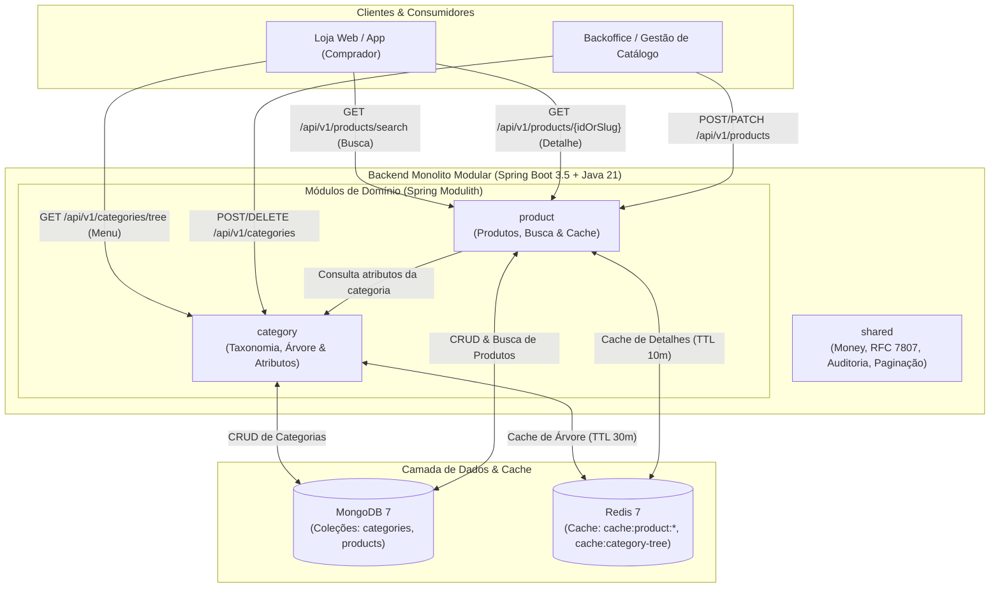
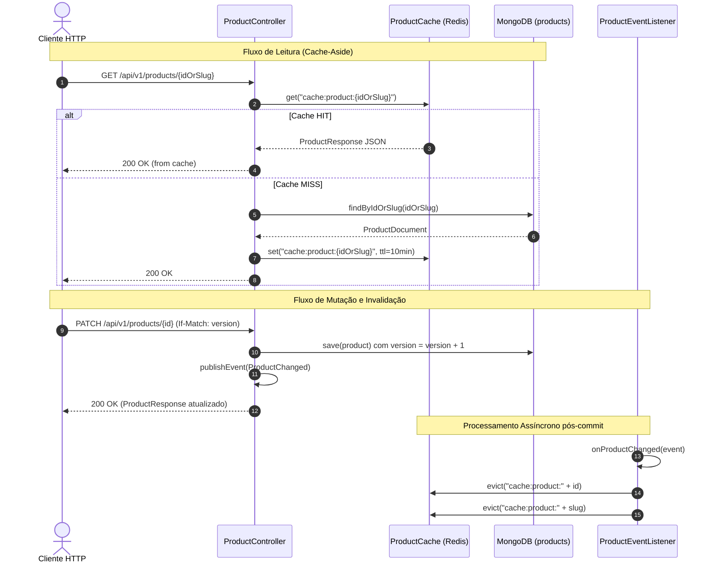
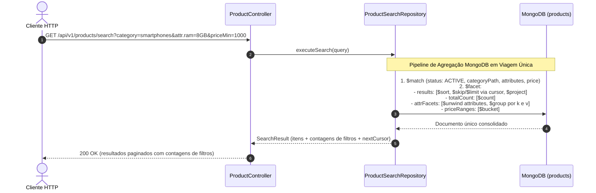
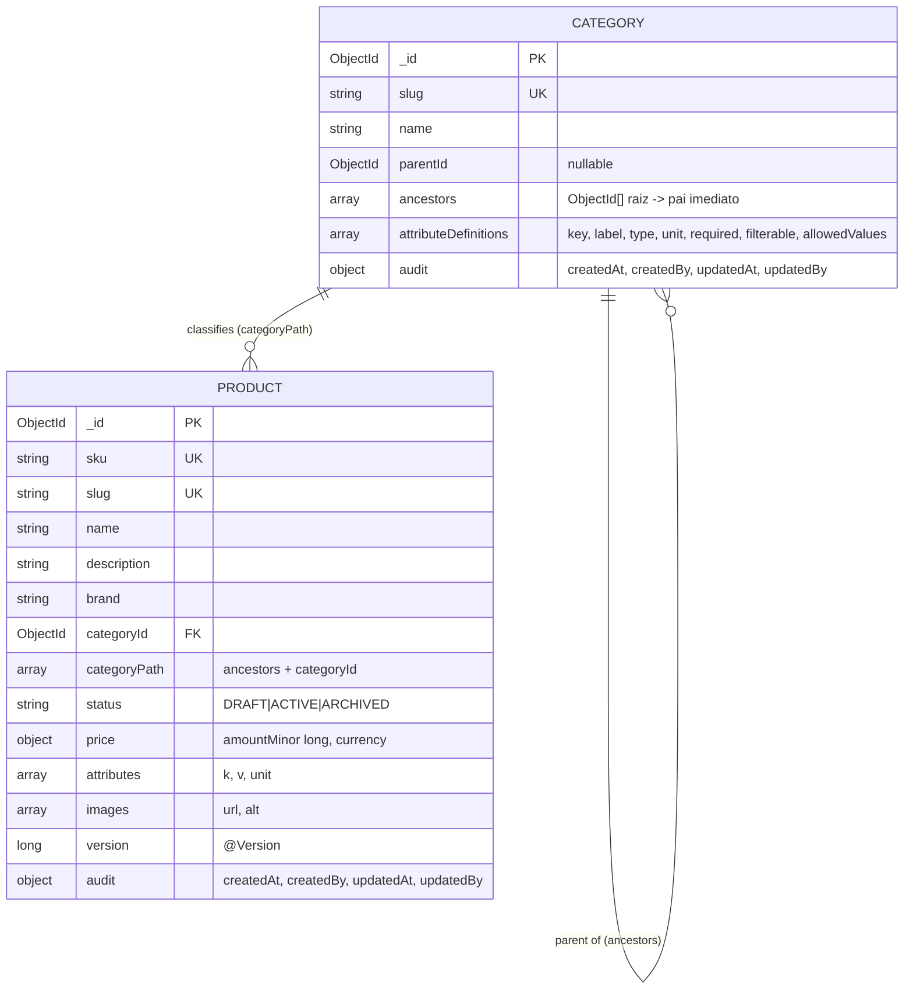

# Especificação de Requisitos e Modelagem — E-commerce Catalog & Faceted Search Engine

**Versão:** 2.0  
**Data:** Outubro de 2026  
**Status:** Aprovado para Planejamento de Tarefas (`task-plan`)  
**Domínio:** Catálogo de Produtos com Atributos Heterogêneos, Taxonomia Hierárquica, Busca Facetada e Cache de Baixa Latência  
**Documentos Relacionados:** [ARCHITECTURE.md](file:///workspace/ecommerce-catalog/docs/ARCHITECTURE.md), [CODING_GUIDELINES.md](file:///workspace/ecommerce-catalog/docs/CODING_GUIDELINES.md) e [TEMPLATE_TAREFA.md](file:///workspace/ecommerce-catalog/docs/TEMPLATE_TAREFA.md)

---

## 1. Visão Geral do Problema

Este projeto especifica um **Motor de Catálogo e Busca de Produtos para E-commerce**, projetado como um **Monolito Modular em Java (Spring Modulith)** utilizando **MongoDB** e **Redis**.

O foco de engenharia é resolver os desafios clássicos de dados e busca de catálogos modernos:
- **Esquema flexível com governança:** Permitir que celulares, sapatos e móveis compartilhem a mesma coleção sem recorrer ao antipadrão relacional EAV (Entity-Attribute-Value), mantendo a garantia de validação de tipos, enums e campos obrigatórios definidos por categoria.
- **Modelagem para busca eficiente (*Attribute Pattern*):** Representar especificações dinâmicas como arrays de subdocumentos indexados (`attributes: [{ k, v, unit }]`), viabilizando filtros arbitrários sem a necessidade de criar um novo índice para cada atributo que o marketing inventar.
- **Agregações analíticas em tempo real:** Calcular a listagem de produtos e a contagem dinâmica de opções por faceta (ex: quantos produtos têm 8GB de RAM ou 128GB de armazenamento no filtro atual) em **uma única viagem de rede ao banco**, através do estágio `$facet` do MongoDB.
- **Navegação taxonômica rápida (*Ancestors Path*):** Modelar hierarquia de categorias onde a busca em categorias genéricas (ex: "Eletrônicos") abrange automaticamente produtos de subcategorias profundas (ex: "Smartphones") com uma consulta indexada simples.
- **Cache de leitura desacoplado:** Prover leituras sub-milissegundo para os produtos mais acessados via Redis, mantendo a consistência por meio de invalidação cirúrgica orientada a eventos de domínio.

---

## 2. Histórias de Usuário (User Stories)

### US-01: Árvore Hierárquica de Categorias com Definição e Herança de Atributos

**Como** gestor do catálogo,  
**Eu quero** cadastrar categorias organizadas em árvore com definições tipadas de atributos,  
**Para que** subcategorias herdem especificações dos pais e o frontend possa renderizar filtros dinamicamente.

- **Critérios de Aceite:**
  - **Dado** o cadastro de uma nova categoria via `POST /api/v1/categories`, **Quando** informada com um `parentId` opcional e um `slug` único, **Então** o sistema deve calcular e persistir o array `ancestors` contendo a sequência ordenada de IDs da raiz até o pai imediato.
  - **Dado** que uma categoria define `attributeDefinitions` (cada uma contendo `key`, `label`, `type` [`ENUM`, `NUMBER`, `STRING`, `BOOLEAN`], `unit`, `required`, `filterable` e `allowedValues`), **Quando** consultada, **Então** o sistema deve retornar as definições efetivas resultantes da união da cadeia de ancestrais com as regras locais.
  - **Dado** uma tentativa de subcategoria redefinir uma `key` de atributo já existente em um de seus ancestrais, **Então** a requisição deve ser rejeitada com `422 INVALID_ATTRIBUTE_DEFINITION`.
  - **Dado** uma categoria que possui subcategorias filhas ou produtos associados, **Quando** for solicitado `DELETE /api/v1/categories/{id}`, **Então** a API deve rejeitar a exclusão com `409 CATEGORY_NOT_EMPTY`.
  - **Dado** `GET /api/v1/categories/tree`, **Quando** executado, **Então** deve retornar a árvore completa com cache no Redis (`cache:category-tree`, TTL de 30 minutos), invalidado diretamente via `CacheService` após qualquer criação ou exclusão de categoria.

---

### US-02: Cadastro e Ciclo de Vida de Produtos Heterogêneos com Validação Estrita

**Como** operador de produtos,  
**Eu quero** cadastrar e editar produtos com atributos dinâmicos específicos da sua categoria,  
**Para que** o catálogo preserve a integridade dos dados e suporte concorrência sem sobrescritas acidentais.

- **Critérios de Aceite:**
  - **Dado** uma categoria que exige `ram` (ENUM) e `storageGb` (NUMBER), **Quando** `POST /api/v1/products` for enviado sem `ram` ou com atributo não declarado na categoria, **Então** o sistema deve rejeitar com `422 INVALID_PRODUCT_ATTRIBUTES` indicando os erros específicos.
  - **Dado** um produto válido com `price` (Money com `amountMinor` e `currency`), `sku` único, `slug` único e `attributes`, **Quando** persistido, **Então** deve salvar no formato de *Attribute Pattern* (`[{ k, v, unit }]`), desnormalizar `categoryPath` (`ancestors + categoryId`), definir `status = DRAFT` e `version = 0`.
  - **Dado** `POST /api/v1/products/{id}/publish`, **Quando** chamado sobre um produto `DRAFT`, **Então** o status deve mudar para `ACTIVE` e o evento `ProductChanged` deve ser publicado.
  - **Dado** `POST /api/v1/products/{id}/archive`, **Quando** chamado sobre um produto `ACTIVE`, **Então** o status deve mudar para `ARCHIVED` e o evento `ProductChanged` deve ser publicado.
  - **Dado** duas requisições concorrentes de `PATCH /api/v1/products/{id}` enviando o mesmo `version` via header `If-Match`, **Quando** processadas, **Então** exatamente uma deve ter sucesso incrementando `version` e a outra deve ser rejeitada com `409 CONCURRENT_MODIFICATION`.

---

### US-03: Busca de Produtos com Filtros Dinâmicos (Atributos, Categoria e Preço)

**Como** cliente da loja virtual,  
**Eu quero** pesquisar produtos combinando texto livre, categoria, faixa de preço e atributos específicos, vendo a contagem de itens por opção de filtro,  
**Para que** eu encontre o produto ideal refinando as opções de busca na listagem.

- **Critérios de Aceite:**
  - **Dado** `GET /api/v1/products/search` com parâmetros opcionais `q` (texto livre), `category` (slug), `priceMin`, `priceMax`, `sort` e filtros de atributos dinâmicos `attr.<key>=<value>` (repetíveis), **Quando** executado, **Então** deve filtrar somente produtos com `status = ACTIVE`.
  - **Dado** o filtro `category=eletronicos`, **Quando** executado, **Então** a busca deve retornar produtos associados diretamente à categoria ou a qualquer subcategoria descendente através do filtro indexado em `categoryPath`.
  - **Dado** múltiplos valores para o mesmo atributo (`attr.ram=8GB&attr.ram=16GB`), **Quando** executado, **Então** deve aplicar lógica de **OU** entre eles; para atributos distintos (`attr.ram=8GB&attr.storageGb=256`), deve aplicar lógica de **E**.
  - **Dado** o processamento da busca, **Quando** executado no MongoDB, **Então** deve utilizar um **único estágio `$facet`** gerando:
    1. `results`: lista de produtos paginada e ordenada.
    2. `totalCount`: contagem total de produtos que casam com os filtros.
    3. `facets`: contagem por valor para cada atributo `filterable` da categoria informada.
    4. `priceRanges`: contagem distribuída em faixas predefinidas de preço.
  - **Dado** grandes volumes de resultados, **Quando** paginados, **Então** a paginação deve utilizar cursor opaco codificado em Base64URL (`nextCursor`), garantindo ordenação estável sem o uso do operador `$skip` em posições profundas.

---

### US-04: Detalhe de Produto com Cache-Aside e Invalidação Cirúrgica

**Como** visitante da loja,  
**Eu quero** acessar a página de um produto com tempo de resposta sub-milissegundo,  
**Para que** a navegação seja fluida sem risco de visualização de dados inconsistentes após atualizações.

- **Critérios de Aceite:**
  - **Dado** `GET /api/v1/products/{idOrSlug}`, **Quando** a chave `cache:product:{idOrSlug}` existir no Redis (Cache HIT), **Então** o payload deve ser servido diretamente da memória sem consultar o MongoDB.
  - **Dado** que a chave não existe no Redis (Cache MISS), **Quando** a rota for chamada, **Então** o produto deve ser lido do MongoDB, gravado no Redis com TTL de 10 minutos e retornado ao cliente.
  - **Dado** a publicação do evento de domínio `ProductChanged` (após commit de criação, alteração ou mudança de status), **Quando** o listener do cache processar a mensagem, **Então** as chaves correspondentes ao `id` e `slug` do produto devem ser removidas atomicamente do Redis.
  - **Dado** que a instância do Redis esteja indisponível ou sofra timeout, **Quando** qualquer consulta de detalhe for disparada, **Então** o sistema deve fazer fallback transparente consultando o MongoDB, registrando log `WARN` e métrica operacional sem devolver erro HTTP ao cliente.
  - **Dado** um produto com `status` diferente de `ACTIVE`, **Quando** consultado pela rota pública, **Então** o sistema deve retornar `404 PRODUCT_NOT_FOUND`.

---

### US-05: Observabilidade, Auditoria e Saúde Operacional

**Como** engenheiro de plataforma,  
**Eu quero** monitorar métricas de catálogo, hits de cache e logs correlacionáveis,  
**Para que** anomalias de busca e degradações de cache sejam detectadas preventivamente.

- **Critérios de Aceite:**
  - O sistema deve expor endpoints `/actuator/health/liveness` e `/actuator/health/readiness`. O readiness check deve falhar se o MongoDB estiver inacessível; se apenas o Redis estiver inacessível, o status deve reportar `DEGRADED`, mantendo o serviço apto a receber tráfego.
  - O sistema deve exportar métricas via Micrometer para: latência de busca (`catalog.search.duration`), contadores de cache (`catalog.cache.hits`, `catalog.cache.misses`, `catalog.cache.errors`) e produtos cadastrados por status.
  - Toda mutação nas coleções `categories` e `products` deve armazenar o objeto de auditoria imutável `audit` com `createdAt`, `createdBy`, `updatedAt` e `updatedBy` preenchidos via `AuditorAware`.
  - O sistema deve expor `/actuator/modulith` comprovando o desacoplamento arquitetural entre os módulos.

---

## 3. Catálogo de Requisitos

### 3.1 Requisitos Funcionais (RF)

| ID | Descrição | Prioridade |
| :---: | :--- | :---: |
| **RF-01** | O sistema deve encapsular preços no Value Object imutável `Money` (`long amountMinor` + `Currency`), trafegando como decimal em JSON e `Long` no MongoDB. | Alta |
| **RF-02** | O sistema deve manter categorias com hierarquia em árvore (`ancestors`), `slug` único e herança determinística de definições de atributos. | Alta |
| **RF-03** | O sistema deve cadastrar produtos no *Attribute Pattern* (`[{ k, v, unit }]`), validando tipos, enums e obrigatoriedade contra a categoria. | Alta |
| **RF-04** | O sistema deve gerenciar o ciclo de vida do produto (`DRAFT` → `ACTIVE` → `ARCHIVED`) com controle de concorrência otimista via `@Version`. | Alta |
| **RF-05** | O sistema deve executar busca de produtos com filtros combinados (texto, categoria hierárquica, faixa de preço e atributos dinâmicos), retornando produtos e contagens por filtro em pipeline único (`$facet`). | Alta |
| **RF-06** | O sistema deve fornecer paginação estável por cursor opaco Base64URL em listagens e buscas. | Alta |
| **RF-07** | O sistema deve implementar padrão Cache-Aside no Redis para produtos e taxonomia com invalidação cirúrgica (via evento `ProductChanged` para produtos e evicção direta via `CacheService` para categorias). | Alta |
| **RF-08** | O sistema deve garantir fallback automático e transparente para o MongoDB caso o Redis fique indisponível. | Média |

### 3.2 Requisitos Não-Funcionais (RNF)

| ID | Categoria | Descrição Mensurável | Prioridade |
| :---: | :--- | :--- | :---: |
| **RNF-01** | Performance (Cache) | Detalhe de produto com Cache HIT deve ter latência p95 ≤ 15ms. | Alta |
| **RNF-02** | Performance (Busca) | Busca de produtos sobre 50.000 itens com filtros dinâmicos deve ter latência p95 ≤ 120ms (com índices cobertos). | Alta |
| **RNF-03** | Modularidade Estrita | A validação `ApplicationModules.verify()` do Spring Modulith deve passar limpa sem violações de fronteiras. | Alta |
| **RNF-04** | Integridade de Esquema | Nenhum índice deve ser criado em runtime (`auto-index-creation = false`). Todo DDL deve ser versionado via Mongock. | Alta |
| **RNF-05** | Padronização de Erros | Respostas de erro devem aderir à RFC 7807 (`ProblemDetail`) com taxonomia estável de `FailureCode`. | Alta |
| **RNF-06** | Auditoria e Rastreabilidade | Todo log deve conter `correlationId` propagado via MDC e metadados de autoria em mutações. | Média |

---

## 4. Restrições Invioláveis de Engenharia

1. **Proibido `float` ou `double` para valores monetários:** Valores são representados em centavos (`long amountMinor`) acompanhados do código de moeda ISO-4217.
2. **Proibido consultas entre módulos via banco de dados:** Um módulo nunca injeta repositórios nem lê coleções pertencentes a outro domínio.
3. **Proibido criação de novos índices no código ou runtime:** Todos os índices MongoDB devem residir exclusivamente em ChangeUnits versionados do Mongock.
4. **Proibido alteração de ChangeUnits já comitados:** Evoluções de schema exigem um novo ChangeUnit incremental numerado.
5. **Proibido chaves no Redis sem TTL:** Todas as chaves em memória devem possuir expiração explícita.
6. **Proibido falha catastrófica da API por indisponibilidade do Redis:** Erros de cache devem degradar com fallback transparente para o MongoDB.
7. **Proibido paginação por `$skip` em buscas profundas:** Toda navegação de listagem deve utilizar cursor determinístico.

---

## 5. Matriz de Rastreabilidade

| Requisito | User Story | Componente / Endpoint / Serviço | Teste Automatizado Obrigatório |
| :---: | :---: | :--- | :--- |
| **RF-01** | Todas | `shared/money/Money` | `MoneyTest.shouldEnforceExactDecimalArithmetic` |
| **RF-02** | US-01 | `POST /api/v1/categories` / `CategoryService` | `CategoryHierarchyIT.shouldInheritAncestorsAttributes` |
| **RF-03** | US-02 | `POST /api/v1/products` / `AttributeValidator` | `ProductValidationIT.shouldRejectUndeclaredOrInvalidAttributes` |
| **RF-04** | US-02 | `PATCH /api/v1/products/{id}` / `ProductService` | `ProductConcurrencyIT.shouldRejectConcurrentModification` |
| **RF-05** | US-03 | `GET /api/v1/products/search` / `ProductSearchRepository` | `ProductSearchIT.shouldComputeFacetsInSinglePipeline` |
| **RF-06** | US-03 | `CursorPage` / `CursorEncoder` | `CursorPaginationIT.shouldProvideStableCursorPagination` |
| **RF-07** | US-04 | `ProductCache` + `CategoryCache` | `CacheAsideIT.shouldEvictCacheOnProductChangedEvent` |
| **RF-08** | US-04 | `ProductCache` | `CacheFallbackIT.shouldFallbackToMongoWhenRedisFails` |
| **RNF-03** | Todas | `ModularityTests` | `ModularityTests.shouldComplyWithModulithBoundaries` |

---

## 6. Taxonomia de Códigos de Falha (`FailureCode`)

| `FailureCode` | Status HTTP | Significado | Ação do Cliente |
| :--- | :---: | :--- | :--- |
| `VALIDATION_ERROR` | `400 Bad Request` | Parâmetros de entrada inválidos (Bean Validation). | Corrigir payload da requisição. |
| `CATEGORY_NOT_FOUND` | `404 Not Found` | Categoria informada por ID ou slug não existe. | Verificar identificador. |
| `PRODUCT_NOT_FOUND` | `404 Not Found` | Produto inexistente ou com status diferente de `ACTIVE`. | Verificar identificador. |
| `DUPLICATE_SKU` | `409 Conflict` | Já existe um produto cadastrado com o mesmo SKU. | Informar um SKU único. |
| `DUPLICATE_SLUG` | `409 Conflict` | Já existe categoria ou produto com o mesmo slug. | Informar um slug único. |
| `CATEGORY_NOT_EMPTY` | `409 Conflict` | Categoria possui subcategorias filhas ou produtos associados. | Mover ou remover dependentes. |
| `CONCURRENT_MODIFICATION` | `409 Conflict` | Versão do produto no banco difere do header `If-Match`. | Recarregar produto e reenviar. |
| `INVALID_ATTRIBUTE_DEFINITION` | `422 Unprocessable` | Subcategoria tenta sobrescrever atributo de ancestral. | Ajustar definição de atributos. |
| `INVALID_PRODUCT_ATTRIBUTES` | `422 Unprocessable` | Atributos do produto ausentes, de tipo inválido ou não declarados. | Corrigir atributos informados. |

---

## 7. Arquitetura de Componentes e Fluxos (Diagramas)

### 7.1 Diagrama de Arquitetura Geral (Clientes, Backend e Armazenamento)

O diagrama abaixo apresenta a visão sistêmica macro, demonstrando a interação entre os atores externos (comprador e administrador), o backend modular (Spring Modulith) e as camadas de persistência (MongoDB) e cache de baixa latência (Redis):



---

### 7.2 Fluxo de Detalhe de Produto com Cache-Aside e Invalidação Reativa

Demonstra a leitura acelerada no Redis e a invalidação transacional orientada ao evento `ProductChanged`:



---

### 7.3 Fluxo de Busca de Produtos com Filtros Dinâmicos e Contadores

Demonstra a busca de produtos com filtros em viagem única ao MongoDB consolidando resultados paginados, contagem total e contadores por opção de filtro:


    Search->>Repo: executeSearch(query)
    Note over Repo,DB: Pipeline de Agregação MongoDB em Viagem Única
    Repo->>DB: 1. $match (status: ACTIVE, categoryPath, attributes, price)<br/>2. $facet:<br/>   - results: [$sort, $skip/$limit via cursor, $project]<br/>   - totalCount: [$count]<br/>   - attrFacets: [$unwind attributes, $group por k e v]<br/>   - priceRanges: [$bucket]
    DB-->>Repo: Documento único consolidado
    Repo-->>Search: SearchResult (itens + facetas calculadas + nextCursor)
    Search-->>Cliente: 200 OK (resultados paginados com contagens de facetas)
```

---

## 8. Modelo de Dados Físico (MongoDB)

### 8.1 Diagrama de Coleções



### 8.2 Exemplo de Documento `categories`
```json
{
  "_id": { "$oid": "6720f0000000000000000003" },
  "slug": "smartphones",
  "name": "Smartphones",
  "parentId": { "$oid": "6720f0000000000000000002" },
  "ancestors": [
    { "$oid": "6720f0000000000000000001" },
    { "$oid": "6720f0000000000000000002" }
  ],
  "attributeDefinitions": [
    {
      "key": "ram",
      "label": "Memória RAM",
      "type": "ENUM",
      "allowedValues": ["4GB", "8GB", "12GB", "16GB"],
      "required": true,
      "filterable": true
    },
    {
      "key": "storageGb",
      "label": "Armazenamento",
      "type": "NUMBER",
      "unit": "GB",
      "required": true,
      "filterable": true
    },
    {
      "key": "is5g",
      "label": "Conectividade 5G",
      "type": "BOOLEAN",
      "required": false,
      "filterable": true
    }
  ],
  "audit": {
    "createdAt": "2026-10-20T10:00:00Z",
    "createdBy": "admin:carlos",
    "updatedAt": "2026-10-20T10:00:00Z",
    "updatedBy": "admin:carlos"
  }
}
```

### 8.3 Exemplo de Documento `products` (Attribute Pattern)
```json
{
  "_id": { "$oid": "6720f1a2c3d4e5f600000001" },
  "sku": "SMART-GX24-8-256-BLK",
  "slug": "galaxy-x24-8gb-256gb-preto",
  "name": "Galaxy X24 8GB 256GB Preto",
  "brand": "Samsung",
  "description": "Smartphone com tela AMOLED de 6.5 polegadas...",
  "categoryId": { "$oid": "6720f0000000000000000003" },
  "categoryPath": [
    { "$oid": "6720f0000000000000000001" },
    { "$oid": "6720f0000000000000000002" },
    { "$oid": "6720f0000000000000000003" }
  ],
  "status": "ACTIVE",
  "price": {
    "amountMinor": 349990,
    "currency": "BRL"
  },
  "attributes": [
    { "k": "ram", "v": "8GB" },
    { "k": "storageGb", "v": 256, "unit": "GB" },
    { "k": "color", "v": "Preto" },
    { "k": "is5g", "v": true }
  ],
  "images": [
    { "url": "https://cdn.loja.com/gx24-front.jpg", "alt": "Visão frontal" }
  ],
  "version": 1,
  "audit": {
    "createdAt": "2026-10-21T14:30:00Z",
    "createdBy": "admin:maria",
    "updatedAt": "2026-10-22T09:15:00Z",
    "updatedBy": "admin:joao"
  }
}
```

### 8.4 Índices Obrigatórios do MongoDB (Criados via Mongock)

1. **Coleção `categories`:**
   - `{ slug: 1 }` (Unique)
   - `{ parentId: 1 }`
   - `{ ancestors: 1 }`
2. **Coleção `products`:**
   - `{ sku: 1 }` (Unique)
   - `{ slug: 1 }` (Unique)
   - `{ status: 1, categoryPath: 1, "price.amountMinor": 1 }` (Navegação hierárquica e filtro por preço)
   - `{ "attributes.k": 1, "attributes.v": 1 }` (Filtro facetado sobre atributos heterogêneos)
   - Índice de Texto: `{ name: "text", brand: "text", description: "text" }` com pesos `name: 10, brand: 5, description: 1` e `default_language: "portuguese"`.

### 8.5 Estruturas no Redis

| Chave | Tipo | TTL | Conteúdo |
| :--- | :--- | :--- | :--- |
| `cache:product:{idOrSlug}` | STRING (JSON) | 10 min | Snapshot serializado de `ProductResponse` |
| `cache:category-tree` | STRING (JSON) | 30 min | Árvore completa de categorias serializada |

---

## 9. Contratos da API HTTP

### 9.1 Criar Categoria (`POST /api/v1/categories`) — Header `X-Actor: admin:carlos`
- **Request Body:**
```json
{
  "name": "Smartphones",
  "slug": "smartphones",
  "parentId": "6720f0000000000000000002",
  "attributeDefinitions": [
    {
      "key": "ram",
      "label": "Memória RAM",
      "type": "ENUM",
      "allowedValues": ["4GB", "8GB", "12GB", "16GB"],
      "required": true,
      "filterable": true
    },
    {
      "key": "storageGb",
      "label": "Armazenamento",
      "type": "NUMBER",
      "unit": "GB",
      "required": true,
      "filterable": true
    },
    {
      "key": "is5g",
      "label": "5G",
      "type": "BOOLEAN",
      "required": false,
      "filterable": true
    }
  ]
}
```
- **Response (`201 Created`):**
```json
{
  "id": "6720f0000000000000000003",
  "name": "Smartphones",
  "slug": "smartphones",
  "parentId": "6720f0000000000000000002",
  "ancestors": ["6720f0000000000000000001", "6720f0000000000000000002"],
  "effectiveAttributeDefinitions": [
    { "key": "brand", "label": "Marca", "type": "STRING", "required": true, "filterable": true },
    { "key": "ram", "label": "Memória RAM", "type": "ENUM", "allowedValues": ["4GB", "8GB", "12GB", "16GB"], "required": true, "filterable": true },
    { "key": "storageGb", "label": "Armazenamento", "type": "NUMBER", "unit": "GB", "required": true, "filterable": true },
    { "key": "is5g", "label": "5G", "type": "BOOLEAN", "required": false, "filterable": true }
  ]
}
```

### 9.2 Criar Produto (`POST /api/v1/products`) — Header `X-Actor: admin:maria`
- **Request Body:**
```json
{
  "sku": "SMART-GX24-8-256-BLK",
  "slug": "galaxy-x24-8gb-256gb-preto",
  "name": "Galaxy X24 8GB 256GB Preto",
  "brand": "Samsung",
  "description": "Smartphone com tela AMOLED de 6.5 polegadas...",
  "categoryId": "6720f0000000000000000003",
  "price": {
    "amount": "3499.90",
    "currency": "BRL"
  },
  "attributes": {
    "ram": "8GB",
    "storageGb": 256,
    "color": "Preto",
    "is5g": true
  },
  "images": [
    { "url": "https://cdn.loja.com/gx24-front.jpg", "alt": "Visão frontal" }
  ]
}
```
- **Response (`201 Created`):**
```json
{
  "id": "6720f1a2c3d4e5f600000001",
  "sku": "SMART-GX24-8-256-BLK",
  "slug": "galaxy-x24-8gb-256gb-preto",
  "name": "Galaxy X24 8GB 256GB Preto",
  "brand": "Samsung",
  "categoryId": "6720f0000000000000000003",
  "status": "DRAFT",
  "price": { "amount": "3499.90", "currency": "BRL" },
  "attributes": {
    "ram": "8GB",
    "storageGb": 256,
    "color": "Preto",
    "is5g": true
  },
  "version": 0,
  "createdAt": "2026-10-21T14:30:00Z"
}
```

### 9.3 Publicar Produto (`POST /api/v1/products/{id}/publish`)
- **Response (`200 OK`):** Retorna o produto com `status = "ACTIVE"`.

### 9.4 Detalhe de Produto (`GET /api/v1/products/{idOrSlug}`)
- **Response (`200 OK`):** Retorna `ProductResponse` completo (servido do Redis se em cache).

### 9.5 Busca de Produtos com Filtros Dinâmicos (`GET /api/v1/products/search`)
- **Query Parameters:**
  - `q`: termo de busca textual (opcional)
  - `category`: slug da categoria (opcional)
  - `attr.<key>`: filtros de atributos (ex: `attr.ram=8GB&attr.ram=16GB&attr.is5g=true`)
  - `priceMin` / `priceMax`: faixa de valor monetário
  - `sort`: `relevance` (default com `q`), `priceAsc`, `priceDesc`, `newest`
  - `cursor`: cursor opaco de paginação anterior
  - `limit`: quantidade máxima por página (padrão 20, máximo 50)
- **Response (`200 OK`):**
```json
{
  "items": [
    {
      "id": "6720f1a2c3d4e5f600000001",
      "sku": "SMART-GX24-8-256-BLK",
      "slug": "galaxy-x24-8gb-256gb-preto",
      "name": "Galaxy X24 8GB 256GB Preto",
      "brand": "Samsung",
      "price": { "amount": "3499.90", "currency": "BRL" },
      "thumbnailUrl": "https://cdn.loja.com/gx24-front.jpg"
    }
  ],
  "totalCount": 53,
  "facets": {
    "ram": [
      { "value": "8GB", "count": 42 },
      { "value": "16GB", "count": 11 }
    ],
    "storageGb": [
      { "value": "128", "count": 15 },
      { "value": "256", "count": 38 }
    ],
    "is5g": [
      { "value": "true", "count": 45 },
      { "value": "false", "count": 8 }
    ],
    "priceRanges": [
      { "from": "0.00", "to": "1999.99", "count": 7 },
      { "from": "2000.00", "to": "3999.99", "count": 36 },
      { "from": "4000.00", "to": null, "count": 10 }
    ]
  },
  "nextCursor": "ZXlKcElqb3pNVEk1T1RBc0ltbG1JanBv..."
}
```

---

## 10. Sugestão de Ordem de Implementação (Épicos para `task-plan`)

| # | Épico / Tarefa | Entregas Concretas | Depende de |
| :---: | :--- | :--- | :---: |
| **001** | **Setup Inicial do Projeto** | Projeto Maven, `docker-compose.yml` (MongoDB 7 + Redis 7), módulo `shared` (`Money`, `DomainException`, RFC 7807 handler, `AuditMetadata`, paginação), Mongock configurado e Testcontainers compartilhado. | — |
| **002** | **Autenticação Dev JWT e Segurança** | Spring Security stateless, `JwtAuthenticationFilter`, endpoint `POST /api/v1/auth/dev-token` para gerar tokens de `ADMIN` e `USER` de teste e integração com `AuditorAware`. | 001 |
| **003** | **Taxonomia e Categorias** | US-01: Documento `CategoryDocument`, repositório, serviço, cálculo de `ancestors`, resolução de herança de atributos, índices Mongock e cache da árvore no Redis. | 002 |
| **004** | **Gestão de Produtos** | US-02: Documento `ProductDocument` com Attribute Pattern, `AttributeValidator` validando contra `CategoryApi`, ciclo `DRAFT`/`ACTIVE`/`ARCHIVED`, versionamento otimista `@Version` e evento `ProductChanged`. | 003 |
| **005** | **Busca de Produtos** | US-03: `ProductSearchRepository` com pipeline de agregação `$match` + `$facet`, filtros dinâmicos, paginação determinística por cursor opaco e índices compostos de busca e atributos. | 004 |
| **006** | **Cache-Aside e Invalidação** | US-04: Componente `ProductCache` no Redis, listener assíncrono consumindo `ProductChanged`, testes de concorrência e resiliência com fallback para MongoDB. | 004 |
| **007** | **Observabilidade e Auditoria** | US-05: Health checks (`liveness`/`readiness` com degradação do Redis), métricas Micrometer de busca e cache, auditoria via `AuditorAware` e validação arquitetural via Spring Modulith. | 005, 006 |
